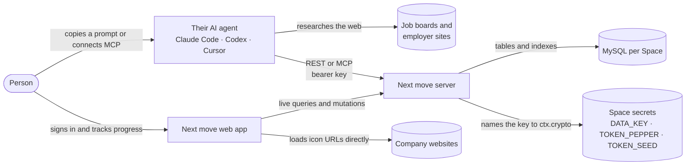

# Next move — engineering documentation

Next move is a multi-user job-search tracker with a deliberately unusual architecture:
**the app never runs an AI**. The person uses the agent they already have (Claude Code,
Codex, Cursor, …). That agent researches openings on the web, explains why each one fits,
and writes the results back through a narrow, per-user API. Next move stores the results,
enforces the rules, and gives the person a UI to track progress.

The codebase is a Spacefast Zero capsule: TypeScript + Preact, live queries, mutations,
HTTP endpoints, a MySQL database per Space, and platform-provided sign-in.

## Start here

| I want to understand… | Read |
| --- | --- |
| The big picture, components, module graph, request paths, design decisions | [architecture.md](architecture.md) |
| Tables, fields, indexes, encryption classification, limits and invariants | [data-model.md](data-model.md) |
| Sign-in/join, prompt handoff, MCP, onboarding, update runs, deletion, legacy upgrade | [flows.md](flows.md) |
| Trust boundaries, authn/authz, the crypto scheme, threat model and residual risks | [security.md](security.md) |
| REST routes, MCP tools, payload shapes, validation, error semantics | [api.md](api.md) |
| Dependencies, environment variables, deploy, tests, known limitations, extension guide | [operations.md](operations.md) |

## The idea in one diagram



Three things are worth noticing in that picture:

1. **The research loop is outside the app.** Next move never calls a model and never scrapes a
   job board. The prompt is the product surface, and the API is the guardrail.
2. **The browser and the agent use different doors.** The browser uses live queries and
   mutations; the agent uses REST endpoints or an MCP JSON-RPC endpoint. Both doors meet in
   `server/data.ts`.
3. **The database is not trusted with readable private data.** Private fields are encrypted
   with a key the handler names but never sees; owner IDs are keyed hashes.

## Feature map

| Page | What it does | Reads / writes |
| --- | --- | --- |
| `/` Opportunities | Pipeline tabs (In play, Shortlisted, Applied, Interviewing, Offers, Closed out, Not interested), stats, search, role/fit/availability filters, five sort modes, inline status changes, "not interested" shortcut, apply link, and a detail drawer with fit, eligibility, compensation, highlights, caveats, company brief, tags, private notes, dates and source. The active tab, search, filters and sort persist in `localStorage`, so a reload keeps the view. Export is on the profile page. | `workspace` query; `setStatus`, `saveNotes` mutations |
| `/agent` Your agent | Chooses the connection lane (one-time code or MCP), generates onboarding/update prompts, creates MCP keys with copy-paste setup for Claude Code/Cursor/Codex, lists connected agents with revoke, and shows recent runs. | `workspace`, `agentActivity` queries; `createHandoff`, `createMcpKey`, `revokeKey` mutations |
| `/profile` Profile & roles | The distilled profile (headline, summary, location, work authorization, remote preference, strengths, "agents must not assume", dealbreakers, sources), roles with salary targets and an active/paused switch, export-everything JSON, and "Delete my data". | `workspace` query; `setTrackActive`, `deleteAccount` mutations |
| Layout (all pages) | Auth and membership gate: landing, claim-a-seat, returning-member upgrade, no-access/full screens, and the member shell with navigation. | `viewer` query; `join`, `deleteAccount` mutations |

Additional UI behavior worth knowing:

- **New badge**: shortlisted, open, and first found within the last 7 days.
- **Needs recheck**: open listing whose `lastVerified` is more than 14 days old.
- **Company marks**: the agent supplies an icon URL read from the company's homepage; the
  browser loads it directly, falling back to `https://<host>/favicon.ico`, then to the
  company's initial. Requests use `referrerpolicy="no-referrer"`, and no server proxy exists
  because Zero handlers do not fetch.
- **Staging is visually loud**: if `location.hostname` contains `staging`, the sidebar turns
  red and a Staging badge appears.
- **Accessibility**: skip link, semantic landmarks and labels, keyboard-operable row title,
  native `<dialog>` drawer with focus management, and reduced-motion handling.

## The data flow in one paragraph

A signed-in visitor first gets a `viewer` state. If there is room (or an invitation), the
`join` mutation writes a `members` row keyed by a hash of their account ID and a hash of
their verified email. A joined member opens **Your agent** and generates a prompt. In HTTP
mode, the `createHandoff` mutation stores only a hash of a one-time code; the prompt carries
the plaintext code to the agent. The agent exchanges that code at `POST /api/agent/session`
for a six-hour `nmk_…` key (also stored only as a hash). In MCP mode, the user creates a
90-day key directly. Either way, the agent calls `get_context`, then `save_profile`,
`save_tracks`, `save_jobs`, optionally `save_company_icons`, and finally `log_run`. Every
agent batch validates the whole payload before the first write, encrypts private fields, scopes
rows to the key's owner, and calls `ctx.invalidate()`, so open pages refresh without polling.
Only the person can change application status or notes, and agents never receive notes.

## Repository at a glance

```
shared/contract.ts   Validation, enums, limits, URL/date helpers (pure TypeScript)
shared/prompts.ts    Onboarding/update prompts and the agent guide
server/index.ts      Capsule: schema, queries, mutations, HTTP endpoints
server/data.ts       Every read/write: views, agent ops, user ops, credentials
server/access.ts     Membership: cap, invitations, blocking, viewer state, join
server/sealed.ts     Which fields are encrypted; legacy-row upgrade
server/vault.ts      SIV-style encryption and keyed hashes, built on HMAC-SHA256
server/tokens.ts     Secret minting and hashing, time helpers
server/mcp.ts        Stateless MCP over Streamable HTTP (JSON responses, no SSE)
client/              Layout, shared UI, job drawer, delete dialog, types
pages/               The three client-rendered pages
tests/               Node tests against an in-memory fake of the Zero context
```

## Quick facts

| Fact | Value |
| --- | --- |
| Runtime | Spacefast Zero 0.8.0, QuickJS server runtime, MySQL per Space |
| UI | Preact 10.29.8 + `@spacefast/zero/client`, kit and Tailwind tokens |
| Pages | `/`, `/agent`, `/profile` (all client-rendered) |
| Server surface | 3 queries, 11 mutations, 9 REST agent routes, 1 MCP route (plus GET/DELETE `405`) |
| Tables | 8: `profiles`, `tracks`, `jobs`, `agentKeys`, `handoffs`, `members`, `runs`, `logs` |
| Agent lanes | One-time code → 6-hour key (REST); 90-day key (MCP) |
| Code lifetime | 30 minutes, single use |
| Private data | Sealed with DATA_KEY; owner IDs and emails are keyed hashes |
| Prod dependencies | `@spacefast/zero`, `preact` (no ORM, HTTP client, auth library or CSS pipeline) |
| Tests | 33 Node tests over an in-memory fake context; `npm test` + `npm run typecheck` |

## Conventions used in this documentation

- "Agent" means the user's own AI tool, never a model run by Next move.
- "Sealed" means encrypted by `server/vault.ts`; "hashed" means a keyed hash used for lookup.
- All diagrams are Mermaid. GitHub, GitLab, and most IDEs with Mermaid support render them.
- An arrow `A --> B` in a dependency diagram means **A imports B**.
- Sequence diagrams are intent-level; the exact database calls are the `ctx.db` operations
  described in [data-model.md](data-model.md).
- External links and job data are untrusted input. The diagrams reflect what the code
  enforces, not what a prompt asks an agent to do.

## Glossary

| Term | Meaning |
| --- | --- |
| **Viewer** | The signed-in person's access state: `signed_out`, `can_join`, `no_access` or `member`. Computed by the `viewer` query. |
| **Member** | A person who claimed a seat (or was invited), stored as a `members` row keyed by `ownerId` and `emailHash`. Signing in alone does not make someone a member. |
| **Owner ID** | `o1_…`, a keyed hash of the platform account ID. Every user-owned row is scoped by it. |
| **Track** | A role the person is searching for (title, seniority, salary target, search notes, active/paused). Called "role" in the UI. |
| **Job** | A researched opening: public posting data plus the agent's judgment and the user's status/notes. |
| **Handoff** | A one-time `nmh_…` code embedded in a prompt. Exchanged for a 6-hour session key. |
| **Session key** | An `nmk_…` bearer key for the REST lane, valid 6 hours. |
| **MCP key** | An `nmk_…` bearer key for the MCP lane, valid 90 days, revocable. |
| **Sealed** | Encrypted with `DATA_KEY` in the SIV-style scheme; decrypted only through `openRow`. |
| **Legacy row** | A row written before encryption, still using the raw account ID as `ownerId` and possibly plaintext private fields. Upgraded on join or first write-capable agent request. |
| **Block** | An operator env-list action that stops a person and all their agents, frees their seat, and keeps their data. |
| **Revoke** | A user action that invalidates one agent key immediately. |

## Validating your understanding

The fastest way to check a claim in these docs is to follow the code:

1. Read `server/index.ts` for the public surface (schema, queries, mutations, endpoints).
2. Read `server/data.ts` for the rules and the only path to user rows.
3. Read `server/access.ts` for who is allowed in, and `server/vault.ts` for what is readable.
4. Read `server/mcp.ts` for the MCP protocol handling.
5. Run `npm test` and `npm run typecheck`; the suite is the executable specification.
