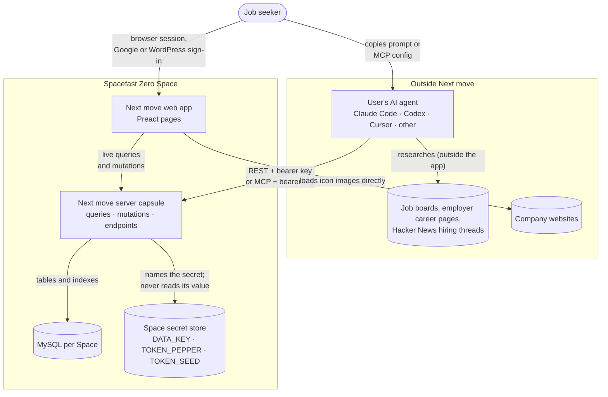
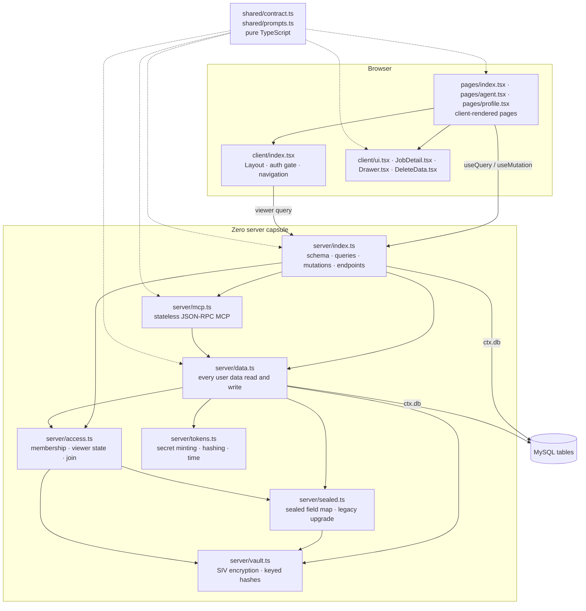
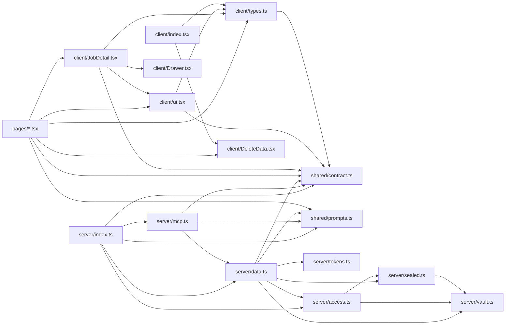
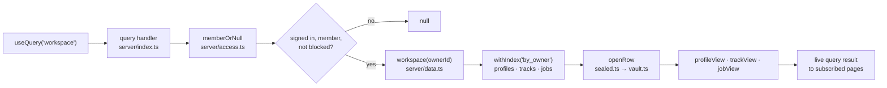
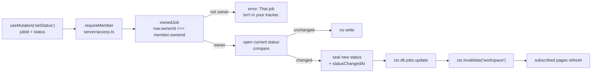
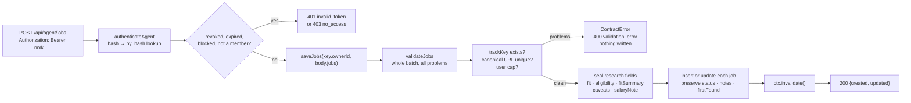
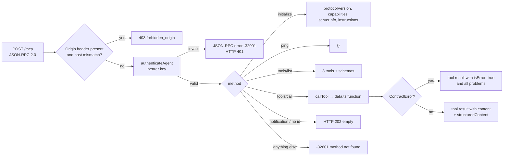

# Architecture

This document explains how Next move is put together: the moving parts, how they depend on
each other, how a request travels, and which design choices are deliberate.

## 1. Product design in one page

Most job trackers either (a) scrape boards and run their own model, or (b) ask the user to
maintain a spreadsheet. Next move takes a third position:

- **The user brings the AI.** A prompt tells their existing agent what to ask, how to
  research, how to judge fit, and how to save results. Prompts are generated fresh, so a
  changed prompt is a deployment, not a migration.
- **The app owns the record, not the research.** Next move stores a distilled profile,
  search roles, researched openings, the user's private judgment of each opening, and the
  user's application progress.
- **The agent gets a narrower door than the user.** An agent can read context and write
  research, but it can never change application status or notes, read notes, delete
  anything, or touch another owner's rows.
- **The operator should not be able to read private data casually.** Private fields are
  encrypted; owner IDs and emails are keyed hashes. This is a speed bump against a glance
  at the dashboard or `sf db dump`, not a defense against the platform itself.

Two connection lanes serve different agent ecosystems:

| Lane | Setup | Credential | Best for |
| --- | --- | --- | --- |
| REST | Paste a prompt containing a one-time code | `nmk_…` key, 6 hours | Any agent that can make HTTP requests |
| MCP | Configure the `/mcp` URL and a bearer key | `nmk_…` key, 90 days | Claude Code, Cursor, Codex (tools instead of raw HTTP) |

## 2. System context

There is no arrow from Next move to a model provider and no arrow from Next move to a job
board. The app makes no outbound HTTP calls; the browser fetches company icons directly from
company sites.

## 3. Containers and components

### Why the server side is split this way

| Module | Owns | Key exports |
| --- | --- | --- |
| `server/index.ts` | The capsule declaration: tables and indexes, queries, mutations, endpoint routing, HTTP error mapping. | `viewer`, `workspace`, `agentActivity`; `join`, `setStatus`, `saveNotes`, `setTrackActive`, `addLog`, `setLog`, `deleteLog`, `createHandoff`, `createMcpKey`, `revokeKey`, `deleteAccount`; `/api/agent/*` and `/mcp` |
| `server/data.ts` | The single chokepoint for user data. Agent operations, user operations, views, credentials, authentication of bearer keys. | `workspace`, `agentContext`, `saveProfile/Tracks/Jobs/CompanyIcons`, `addLogs`, `addLog`, `setLog`, `deleteLog`, `setStatus`, `saveNotes`, `deleteAccount`, `authenticateAgent`, `createHandoff`, `redeemHandoff`, `createMcpKey`, `revokeKey`, `logRun` |
| `server/access.ts` | Who is signed in, who is a member, seat counting, invitations, blocking, viewer state, legacy membership. | `viewerOf`, `join`, `memberOrNull`, `requireMember`, `isMember`, `seatsLeft`, `signedInOwnerIds`, `blocked` |
| `server/sealed.ts` | Which fields are encrypted and what they are bound to; one-time upgrade of pre-encryption rows. | `SEALED`, `scopeFor`, `openRow`, `upgradeLegacyOwner` |
| `server/vault.ts` | Deterministic authenticated encryption and keyed pseudonyms, using only HMAC-SHA256. | `seal`, `open`, `sealFields`, `openFields`, `ownerIdFor`, `emailHashFor`, `isPseudonym` |
| `server/tokens.ts` | Unguessable secret minting (without `crypto.getRandomValues`) and storage hashes. | `mintSecret`, `hashSecret`, `nowIso`, `isoIn`, `todayIso` |
| `server/mcp.ts` | MCP handshake, tool catalogue, JSON-RPC routing, origin check, tool result shaping. | `handleMcp` |
| `shared/contract.ts` | Validation and enums used by REST, MCP and the UI; URL canonicalization and date helpers. | `STATUSES`, `LIMITS`, `validateProfile/Tracks/Jobs/Icons/Run`, `canonicalUrl`, `ContractError` |
| `shared/prompts.ts` | The text users paste, and the guide served to agents. | `onboardingPrompt`, `updatePrompt`, `agentGuide`, session/handoff/key TTLs |
| `client/` | Layout/auth gate, shared UI, job detail drawer, delete dialog, client-side types. | `Layout`, `JobDetail`, `Drawer`, `DeleteData`, `CompanyMark`, `Select` |
| `pages/` | The three addressable client pages. | `/`, `/agent`, `/profile` |

## 4. Runtime model

Next move is a Zero capsule, so some things that are ordinary in a Node app are absent by
design:

| Concern | How it works here |
| --- | --- |
| Pages | `pages/*.tsx` are client-rendered because each starts with `"use client"`. They export a default component. |
| Layout | `client/index.tsx` exports `Layout`; it is not itself a page. |
| Reads | `useQuery("workspace")` subscribes to a server query. Queries are live: a committed write that calls `ctx.invalidate()` refreshes every subscribed client. There is no polling. |
| Writes | `useMutation("setStatus", …)` calls a server mutation. Mutations run in a transaction; validation happens before the first write. |
| Agent HTTP | `endpoint({ method, path }, handler)` declares literal routes. These are for callers outside the UI (the agent), not for the app's own pages. |
| Database | `ctx.db.<table>` with `get`, `insert`, `update`, `delete`, `collect`, `first`, `take`, `withIndex`. Every call is awaited. |
| Auth | `ctx.auth` on the server, `useAuth()` in the client. Everyone starts as a guest; Google and WordPress.com sign-in are provided by the platform. |
| Secrets | `ctx.env` for non-secret configuration; `ctx.crypto.hmacSha256({ key: "NAME", data })` and `ctx.jwt.sign({ key: "NAME", … })` for secrets. The handler names the secret; it never receives its value. |
| Platform limits | No Node built-ins, no dynamic `import()`, no `require()`, no outbound `fetch` in handlers, no `TextEncoder`/`btoa`/`crypto.getRandomValues`. |
| Styling | Tailwind classes scanned from source; static class strings only; semantic tokens from `theme.json`; no CSS/PostCSS pipeline. |
| Client bundle | The app's own client code must stay under 8 MB; platform modules (`@spacefast/zero/client`, kit, charts, preact, recharts, lucide) are served from platform URLs and exempt. |

The consequence for architecture: **the server is a set of handler functions over a small
schema**, not a long-running service with background jobs, queues, cron, or an ORM. Anything
that looks like a workflow (research, rechecking, icon discovery) lives in the user's agent.

## 5. Module dependency graph

An arrow means **A imports B**. `shared/` imports nothing but its own relative files;
`server/` imports the platform server SDK, its own files, and shared pure TypeScript;
`client/` imports platform client/kit modules, its own files, and shared pure TypeScript.

The important edge is `data --> access|sealed|tokens|vault`: every write that touches private
data passes through the same four helpers. `server/index.ts` does not talk to the vault for
user data; it delegates to `data.ts`.

## 6. Request paths

### 6.1 Browser read

Notes:

- `viewer` is a separate query and is read by `Layout` before any page renders.
- `agentActivity` uses the same membership gate and returns keys plus the latest 20 runs.
- The UI never calls the REST agent routes. It uses queries and mutations only.

### 6.2 Browser write: status

`saveNotes` follows the same shape with a 20,000-character limit and no `statusChangedAt`
change. `setTrackActive` checks `row.ownerId` and flips the boolean. These are the only
mutations that change user-owned state in the UI.

### 6.3 Agent REST write: save jobs

The owner always comes from the authenticated key, never from the request body. That one
fact is the core of cross-user isolation.

### 6.4 MCP request

MCP is deliberately stateless: no sessions, no SSE stream, no server-side conversation.
State lives in MySQL and in the API key. The transport is Streamable HTTP with JSON
responses, which is why `GET` and `DELETE /mcp` answer `405`.

## 7. Cross-cutting principles

### 7.1 One chokepoint for data

Every read or write of a user-owned row goes through `server/data.ts` (or, for membership
itself, `server/access.ts`). The UI, REST and MCP call the same functions. A rule such as
"agents cannot change status" is therefore implemented once, not three times.

### 7.2 Validate before write

`validateProfile`, `validateTracks`, `validateJobs`, `validateIcons` and `validateRun` collect
**every** problem and throw `ContractError` before the first `ctx.db` write. The endpoint
layer turns `ContractError` into a 400 with a `problems` array; unexpected errors are
rethrown so the mutation/endpoint transaction rolls back. This is what makes a rejected batch
save nothing.

### 7.3 Membership on every request

The UI checks `memberOrNull`/`requireMember`; agent requests re-check `isMember` inside
`authenticateAgent`; code redemption re-checks it inside `redeemHandoff`. Blocking a person
therefore stops their agents on the next request, without needing to revoke each key. See
[security.md](security.md) for the full model.

### 7.4 Private data is encrypted at rest

`server/vault.ts` builds deterministic authenticated encryption from HMAC-SHA256 because the
sandbox has no AES and no random source. The context string binds every ciphertext to its
table, owner, row and field. See [security.md](security.md) and
[data-model.md](data-model.md) for the exact fields and format.

### 7.5 Live refresh instead of polling

Writes call `ctx.invalidate()`. `join` invalidates `viewer`, `workspace` and `agentActivity`;
user mutations invalidate `workspace`; agent writes invalidate everything. Pages subscribed
through `useQuery` re-run automatically, including while an agent is writing in another
window.

## 8. Design decisions and tradeoffs

| Decision | Why | Cost / tradeoff |
| --- | --- | --- |
| Bring-your-own-AI instead of a built-in model | No model bill, no prompt/response storage, no scraping infrastructure, and the user keeps their preferred tool. | The quality of research depends on the user's agent and prompt-following. The app cannot verify claims beyond validation. |
| Two agent lanes (REST + MCP) | REST works with anything; MCP gives coding agents proper tools and avoids pasting a new code every run. | Two surfaces to keep in sync. Both are thin wrappers over `data.ts`. |
| Agent API strictly narrower than the UI | Even a compromised or confused agent cannot damage the user's pipeline. | Agents cannot fix a mis-set status or read the user's notes; the user must do it. |
| Single data module | Security rules live in one place and are testable without the platform. | `data.ts` is the largest file and a hotspot for changes. |
| Deterministic SIV-style encryption | No randomness in the sandbox; deterministic output makes the legacy upgrade idempotent and concurrent-safe. | Equal plaintext in the same context produces equal ciphertext, which reveals "this field did not change". |
| Keyed hashes for owner IDs and emails | A database dump can't be joined to the platform's Users page or read as an email list. | The app can't display a stored email; it relies on `ctx.auth` for that. Block lists must be hashed at request time. |
| No foreign keys / unique constraints | Zero's schema is simple and the app enforces relationships and caps in code. | Some invariants are conventions: one profile per owner, unique job keys per owner, and the seat cap is not atomic. |
| Hand-written MCP | Server code can't import npm packages; the protocol surface needed is small. | Only the implemented subset works: initialize, ping, tools/list, tools/call; no SSE, batch, resources or prompts. |
| No server-side fetch | Platform handlers don't fetch; icons are loaded by the browser. | No icon proxy or server-side URL verification; a broken icon URL simply falls back. |
| Live queries | A mutation or agent write refreshes every open page without polling. | Queries re-run whole result sets; with the current caps (1,000 jobs) this is fine. |

## 9. What the architecture intentionally does not have

- No model inference, embeddings, vector store, or AI provider keys.
- No job-board scraping, crawler, queue, worker, cron, or background retry.
- No email sending, file storage, or uploaded CV retention. The CV is read by the agent and
  summarized; only the summary reaches Next move.
- No OAuth authorization server for ChatGPT/Claude.ai connectors (the README lists this as
  not built yet).
- No application-level rate limiting, metrics, tracing, or audit log beyond the `runs` table
  and `agentKeys.lastUsedAt`.
- No cross-user joins, sharing, teams, or admin UI. The operator uses Spacefast's dashboard
  and `sf` commands.
- No separate CSS build, no state-management library, no client-side router beyond the
  platform's `Link`/`useLocation`.

## 10. Performance shape

The data model is owner-scoped and small by design:

- Each workspace read is one `by_owner` index scan per table (`profiles`, `tracks`, `jobs`, `logs`),
  then `openRow` per row. `openRow` decrypts each sealed field with one HMAC per 32-byte
  keystream block plus the tag HMAC. The README's estimate: a 28-job workspace costs a few
  hundred HMACs, and production HMACs are about 0.015 ms.
- Agent context decrypts only `fit` and `status` for each job, not all sealed fields.
- `agentActivity` reads all keys and runs for the owner, sorts, then decrypts only the latest
  20 run summaries.
- `seatsLeft` reads every member row via the built-in `by_creation` index. At the intended
  scale (50 seats plus invitations) that is fine; it avoids a counter that can drift.
- There is no pagination in the UI. The caps (1,000 jobs per user, 12 roles) bound the result
  set. If the product outgrows that, the first changes would be pagination and a lighter
  `workspace` summary query.

Continue with [data-model.md](data-model.md) for the schema, [flows.md](flows.md) for the
end-to-end journeys, and [security.md](security.md) for the trust model.
