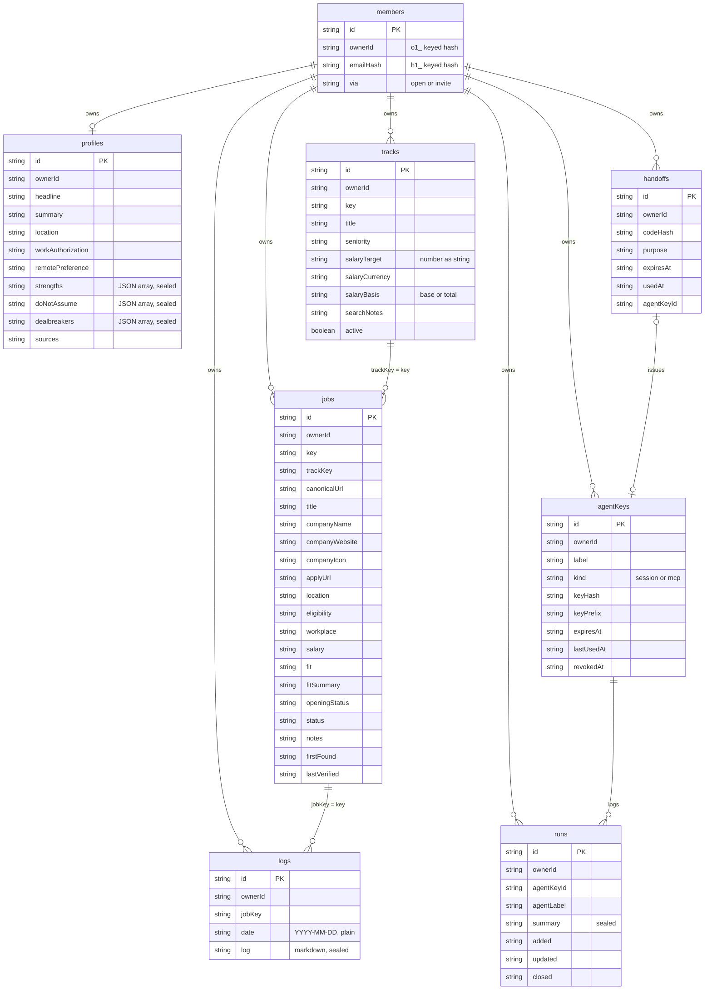

# Data model

Next move keeps eight tables. There are no foreign keys and no unique constraints: the
relationships, ownership checks and caps are enforced in `server/data.ts` and
`server/access.ts`. That makes the schema small and portable, and it makes the application
layer the place to look for invariants.

All tables also have `id`, `createdAt` and `updatedAt` (reserved names, supplied by Zero).
Every table has a `by_owner` index, so a person's rows are always read as one owner-scoped
index scan rather than a table scan.

## 1. Entity-relationship diagram

Logical relationships are shown for orientation only. They are not database foreign keys.

## 2. Tables

### `members` — one row per person who claimed a seat

| Column | Type | Notes |
| --- | --- | --- |
| `ownerId` | string | `o1_…` keyed hash of the sign-in account ID. The membership key. |
| `email` | string | Always `""` for new rows; legacy rows may hold a plaintext email until upgraded. |
| `emailHash` | string | `h1_…` keyed hash of the verified, lowercased email; `""` when the provider has no verified email. |
| `displayName` | string | Always `""` for new rows. Display names are shown from `ctx.auth`, never persisted. |
| `via` | string | `"open"` or `"invite"`. |

`members` is the seat ledger. Signing in does not create a row; pressing **Claim my spot** (or
an invited join) does.

### `profiles` — the distilled profile

| Column | Type | Notes |
| --- | --- | --- |
| `ownerId` | string | Owner hash. |
| `headline` | string | Sealed. Short professional headline. |
| `summary` | string | Sealed. A few paragraphs distilled from the CV/LinkedIn. |
| `location` | string | Sealed. Where the person lives. |
| `workAuthorization` | string | Sealed. Where they can legally work. |
| `remotePreference` | string | Sealed. Remote/hybrid/on-site preference. |
| `strengths` | string | Sealed. JSON array of strings. |
| `doNotAssume` | string | Sealed. JSON array of hard limits on agent claims about the person. |
| `dealbreakers` | string | Sealed. JSON array of strings. |
| `sources` | string | Sealed. What the agent read, e.g. "CV, LinkedIn PDF". |

The app reads the first profile row for an owner and updates it in place. There is no database
unique constraint, so "one profile per owner" is an application convention.

### `tracks` — the roles being searched

| Column | Type | Notes |
| --- | --- | --- |
| `ownerId` | string | Owner hash. |
| `key` | string | Stable lowercase-dashed key, e.g. `engineering-manager`. Plain. |
| `title` | string | Sealed. |
| `seniority` | string | Sealed. |
| `salaryTarget` | string | Sealed. A number stored as a string; `""` means no target. |
| `salaryCurrency` | string | Sealed. Three-letter code. |
| `salaryBasis` | string | Sealed. `"base"` or `"total"`. |
| `searchNotes` | string | Sealed. Titles/scope to look for. |
| `active` | boolean | Plain. Paused roles keep their jobs; agents stop searching for them. |

`saveTracks` matches by `key` and updates or inserts. The per-user cap is 12. The UI exposes
only the active/paused switch; agents own the rest.

### `jobs` — researched openings plus the user's private judgment

This is the largest table and the one with the most mixed classification.

| Column | Type | Storage | Visible to agent? | Notes |
| --- | --- | --- | --- | --- |
| `ownerId` | string | hashed | — | Owner hash. |
| `key` | string | plain | yes | Stable dedupe key chosen by the agent. |
| `trackKey` | string | plain | yes | Must match one of the owner's tracks. |
| `canonicalUrl` | string | plain | no | Derived from `applyUrl`: lowercased scheme/host, no fragment, no trailing slash, tracking params removed. |
| `title` | string | plain | yes | Actual role title. |
| `companyName` | string | plain | yes | |
| `companyWebsite` | string | plain | yes | Absolute http(s) URL. |
| `companyIcon` | string | plain | yes | Absolute https URL, or `""`. |
| `companySummary` | string | plain | no | Public company brief. |
| `companyIndustry` | string | plain | no | |
| `remoteModel` | string | plain | no | |
| `remoteSummary` | string | plain | no | |
| `applyUrl` | string | plain | yes | The employer's own posting. |
| `location` | string | plain | yes | Advertised geography. |
| `eligibility` | string | **sealed** | no | `confirmed`, `likely`, `confirm`. The agent writes it but cannot read it back. |
| `workplace` | string | plain | no | `remote_first`, `remote_role`, `hybrid`, `onsite`. |
| `salary` | string | plain | yes | Published pay, or "Not published". |
| `salaryNote` | string | **sealed** | no | Comparison with the target; judgment about the person. |
| `fit` | string | **sealed** | yes | `strong`, `good`, `stretch`. |
| `fitSummary` | string | **sealed** | no | Why it fits, from profile evidence. |
| `highlights` | string | plain | no | JSON array of strings, about the job only. |
| `caveats` | string | **sealed** | no | JSON array; screening gates, gaps, restrictions. |
| `tags` | string | plain | no | JSON array of short labels. |
| `sourceName` | string | plain | no | Where the agent found it. |
| `sourceUrl` | string | plain | no | |
| `firstFound` | string | plain | yes | `YYYY-MM-DD`. Set once on insert, never changed by `saveJobs`. |
| `lastVerified` | string | plain | yes | `YYYY-MM-DD` the agent actually loaded the posting. |
| `openingStatus` | string | plain | yes | `open`, `closed`, `unknown`. |
| `status` | string | **sealed** | yes | Application status; user-only writes. Default `shortlisted`. |
| `notes` | string | **sealed** | no | User-only, never returned to agents. Default `""`. |
| `statusChangedAt` | string | plain | no | ISO timestamp, set when the user changes status. |

Two asymmetries are deliberate:

1. **Agents write more than they can read.** `save_jobs` sends eligibility, fitSummary,
   caveats and salaryNote, but `get_context` only returns enough to deduplicate and judge:
   key, role key, title, company name/website/icon, apply URL, location, salary, fit,
   opening status, first/last verified dates, and application status.
2. **The user's state is isolated.** `status` and `notes` are sealed and only the user's UI
   mutations write them. `saveJobs` leaves both untouched on update and initializes them on
   insert (`status` sealed as `shortlisted`, `notes` as `""`).

### `agentKeys` — every agent credential

| Column | Type | Notes |
| --- | --- | --- |
| `ownerId` | string | Owner hash. |
| `ownerEmail` | string | Always `""`; legacy plaintext column. |
| `ownerEmailHash` | string | `h1_…` for block checks. |
| `label` | string | User-supplied agent label, sanitized to 60 chars. |
| `kind` | string | `"session"` (6-hour REST key) or `"mcp"` (90-day key). |
| `keyHash` | string | HMAC-SHA256 of the secret under `TOKEN_PEPPER`. Unique enough to look up via `by_hash`. |
| `keyPrefix` | string | First 8 characters of the secret, e.g. `nmk_ab12`, for display. |
| `expiresAt` | string | ISO timestamp. |
| `lastUsedAt` | string | ISO timestamp; updated at most once per minute on write-capable requests. |
| `revokedAt` | string | ISO timestamp or `""`. Revocation is immediate. |

Only the hash is stored. The plaintext `nmk_…` value is shown once and never recoverable.

### `handoffs` — one-time prompt codes

| Column | Type | Notes |
| --- | --- | --- |
| `ownerId` | string | Owner hash. |
| `ownerEmail` | string | Always `""`; legacy plaintext column. |
| `ownerEmailHash` | string | `h1_…`. |
| `codeHash` | string | HMAC-SHA256 of the `nmh_…` code under `TOKEN_PEPPER`. |
| `purpose` | string | `"onboarding"` or `"update"` (included in the session response). |
| `expiresAt` | string | 30 minutes after creation. |
| `usedAt` | string | ISO timestamp or `""`. A used code is refused. |
| `agentKeyId` | string | The session key issued when the code was redeemed. |

Handoffs are never deleted automatically; they are harmless but accumulate. Expired codes
simply fail the `expiresAt` check.

### `runs` — what an agent says it did

| Column | Type | Notes |
| --- | --- | --- |
| `ownerId` | string | Owner hash. |
| `agentKeyId` | string | The key that logged the run. |
| `agentLabel` | string | Copy of the key label at run time. |
| `summary` | string | **Sealed.** Free text shown on **Your agent**. |
| `added` | string | Whole number stored as a string. |
| `updated` | string | Whole number stored as a string. |
| `closed` | string | Whole number stored as a string. |

### `logs` — per-opportunity activity entries

| Column | Type | Storage | Notes |
| --- | --- | --- | --- |
| `ownerId` | string | hashed | Owner hash. |
| `jobKey` | string | plain | The stable key of the job this entry belongs to. |
| `date` | string | plain | `YYYY-MM-DD` of the entry; plain so entries sort without decrypting. |
| `log` | string | **sealed** | Markdown text. |

One row per entry; a job can have many. Agents append entries (`add_logs`) but never read
them back; the user can add, edit and delete them from the opportunity drawer.

## 3. Field classification

### Sealed fields

`server/sealed.ts` is the source of truth. Each value is bound to a context that includes the
table, owner, row key (where one exists) and field name.

| Table | Sealed fields | Scope prefix |
| --- | --- | --- |
| `profiles` | `headline`, `summary`, `location`, `workAuthorization`, `remotePreference`, `strengths`, `doNotAssume`, `dealbreakers`, `sources` | `profiles\|<ownerId>` |
| `tracks` | `title`, `seniority`, `salaryTarget`, `salaryCurrency`, `salaryBasis`, `searchNotes` | `tracks\|<ownerId>\|<key>` |
| `jobs` | `fit`, `eligibility`, `fitSummary`, `caveats`, `salaryNote`, `status`, `notes` | `jobs\|<ownerId>\|<key>` |
| `runs` | `summary` | `runs\|<ownerId>` |
| `logs` | `log` | `logs\|<ownerId>\|<jobKey>` |

Each field then appends `|<field>`, so a stored `jobs` notes value is bound to
`jobs|o1_…|acme-platform-em|notes`. It cannot be moved to another row, owner, table or field
without failing the integrity check.

### Hashed identifiers

| Value | Format | Derivation | Why |
| --- | --- | --- | --- |
| Owner ID | `o1_` + 32 hex | `HMAC(DATA_KEY, "owner|" + accountId)` truncated | Rows can't be matched to the Spacefast Users page without the key. |
| Email hash | `h1_` + 32 hex | `HMAC(DATA_KEY, "email|" + lowercasedEmail)` truncated; `""` stays `""` | Emails are only needed for block-list comparison, never display. |
| Key/code hash | 64 hex | `HMAC(TOKEN_PEPPER, "store:" + secret)` | A database leak cannot be replayed as a credential. |
| Key prefix | first 8 chars | `secret.slice(0, 8)` | Human-friendly identification in the UI. |
| Data key fingerprint | 8 hex | `HMAC(DATA_KEY, "kid|")` truncated | Data sealed under another key fails loudly. |

### Plain fields

Job postings are intentionally plain: title, company, URLs, location, salary, highlights,
tags, sources, dates and statuses such as `openingStatus`. They are public, and the app looks
rows up and deduplicates by them. Plain does **not** mean "safe to share": the combination of
saved jobs still says something about a person. See the residual risks in
[security.md](security.md).

`agentKeys.label` and `runs.agentLabel` are also plain. They are agent names (e.g. "Claude
Code"), not the person's name or email.

## 4. Storage conventions

- **Numbers and dates are strings.** Zero's table vocabulary in this app is `string()`,
  `boolean()` and `id("table")`. `salaryTarget`, `added`, `updated` and `closed` are numeric
  strings; dates are `YYYY-MM-DD`; timestamps are ISO 8601.
- **Arrays are JSON strings.** `strengths`, `doNotAssume`, `dealbreakers`, `highlights`,
  `caveats` and `tags` are `JSON.stringify` output. `parseList` in `data.ts` degrades a
  malformed value to `[]`.
- **Empty string is "absent"** for sealed fields: `seal("")` returns `""`, and `open("")`
  returns `""`. This keeps optional fields cheap and avoids ciphertext for nothing.
- **Timestamps are lexicographically sortable**, so `runs` sorting and expiry comparisons use
  string comparison rather than date parsing.
- **Legacy plaintext columns stay.** `members.email`, `members.displayName`,
  `agentKeys.ownerEmail` and `handoffs.ownerEmail` are always written as `""` by new code.
  They remain because dropping a column needs a manual migration; old rows are cleared when
  upgraded.

## 5. Indexes and access patterns

| Table | Indexes | Reads |
| --- | --- | --- |
| `profiles` | `by_owner` | First row for the owner. |
| `tracks` | `by_owner` | All rows, mapped by `key` in memory. |
| `jobs` | `by_owner` | All rows, mapped by `key` and `canonicalUrl` in memory. |
| `agentKeys` | `by_owner`, `by_hash` | List by owner; authenticate by `keyHash`. |
| `handoffs` | `by_owner`, `by_hash` | List by owner; redeem by `codeHash`. |
| `members` | `by_owner`, plus built-in `by_creation` | Member lookup by owner; seat count in creation order. |
| `runs` | `by_owner` | All rows, sorted in memory, latest 20 decrypted and shown. |
| `logs` | `by_owner` | All rows, grouped by `jobKey` in memory, newest first by date. |

There is no index on `jobs.key`, `tracks.key` or `jobs.trackKey`. The owner scan is the
selectivity boundary; dedupe and uniqueness are in-memory checks. With a 1,000-job cap that
is a deliberate simplification.

## 6. Limits and invariants

### Hard limits

| Limit | Value | Enforced by |
| --- | --- | --- |
| Jobs per save | 25 | `LIMITS.jobsPerSave` in `validateJobs` |
| Jobs per user | 1,000 | `LIMITS.jobsPerUser` in `saveJobs` |
| Roles per user | 12 | `LIMITS.tracksPerUser` in `validateTracks` and `saveTracks` |
| Notes length | 20,000 chars | `LIMITS.notes` in `saveNotes` |
| Log entry length | 20,000 chars | `LIMITS.log` in `validateLogs` |
| Logs per save | 25 | `LIMITS.logsPerSave` in `validateLogs` |
| List items (highlights/caveats) | 12 per list, 300 chars each | `validateJobs` |
| Tags | 12 tags, 40 chars each | `validateJobs` |
| Profile summary | 4,000 chars | `validateProfile` |
| Track search notes | 1,000 chars | `validateTracks` |
| Job fit summary | 1,200 chars | `validateJobs` |
| Icons per batch | 1,000 | `validateIcons` |
| Sealed value size | 60,000 chars | `vault.ts` |
| Handoff code | 30 minutes | `HANDOFF_MINUTES` |
| Session key | 6 hours | `SESSION_HOURS` |
| MCP key | 90 days | `MCP_KEY_DAYS` |
| Member cap | 50 by default (`MEMBER_CAP`) | `memberCap` and `join` |

### Application invariants

| Invariant | Where |
| --- | --- |
| Every row belongs to exactly one owner hash. | Every write takes `ownerId` from the authenticated identity or key; no endpoint accepts an owner ID. |
| A user mutation can only touch its owner's row. | `ownedJob` and the `setTrackActive`/`revokeKey` owner checks. |
| Agents cannot write `status`, `notes` or `firstFound`. | `saveJobs` builds an allowlisted research object; `firstFound` is only set on insert or preserved. |
| Agents never receive notes. | `agentContext` hand-projects fields instead of returning rows. |
| A batch is all-or-nothing. | Validation and sealing happen before the loop of writes; `ContractError` is thrown before any write. |
| A job's role must exist. | `saveJobs` checks `trackKey` against the owner's tracks. |
| One opening, one record. | `canonicalUrl` dedupe; a new key for an existing URL is refused. |
| `firstFound` never changes after insert. | `row.firstFound || job.firstFound || today` on update. |
| A code is single-use. | `redeemHandoff` checks `usedAt`, sets it after issuing the key. |
| A key can be revoked immediately. | `authenticateAgent` checks `revokedAt` on every request. |
| A blocked person's agents stop. | `isMember` is re-checked inside `authenticateAgent` and `redeemHandoff`. |
| Deleting removes every owned row. | `deleteAccount` loops all eight tables for every signed-in owner ID. |
| Agents append log entries but never read them. | `addLogs` writes; `agentContext` omits logs. |
| A log entry's job must exist. | `addLogs`/`addLog` check `jobKey` against the owner's jobs. |

### Concurrency caveats

The schema has no unique constraints, and the README notes that Zero does not document its
isolation level. Two checks-then-insert patterns are therefore not atomic:

- **The last seat.** Two people can both pass `seatsLeft() > 0` and both insert a member row.
  The cap is a growth limit, not a billing guarantee.
- **Duplicate member/profile/key rows.** A concurrent join or a concurrent profile save could
  in principle produce more than one row for the same owner. The app reads the first row, so
  the practical effect is an extra row, not a privilege escalation. The seat count would count
  both.

The legacy upgrade is intentionally safe under concurrency: encryption is deterministic, so
two concurrent upgrades write the same ciphertext.

## 7. Lifecycle and retention

| Data | Created | Expires / removed |
| --- | --- | --- |
| Member row | `join` | Removed by `deleteAccount`; blocking keeps it but stops counting it. |
| Profile | Agent `saveProfile` | Replaced in place; removed by `deleteAccount`. |
| Tracks | Agent `saveTracks` | Upserted by key; removed by `deleteAccount`. |
| Jobs | Agent `saveJobs` | Upserted by key; removed by `deleteAccount`. |
| Notes/status | User UI | Stored until changed or deleted with the account. |
| Handoff | `createHandoff` | 30 minutes; row remains after expiry/use. No cleanup job. |
| Session key | `redeemHandoff` | 6 hours; row remains. |
| MCP key | `createMcpKey` | 90 days or revoke; row remains. |
| Run | `logRun` | No expiry; UI shows the latest 20. |
| Log entry | Agent `add_logs` or user UI | Stored until edited/deleted or the account is deleted. |
| Sign-in account | Spacefast on first sign-in | Not removable by the app; operator action in the Spacefast dashboard. |
| Backups | Spacefast | Outside the app's control; retention undocumented. |

The UI shows at most 25 connected-agent rows (active keys plus MCP keys) and 20 runs, but the
underlying rows are all retained until account deletion or manual operator cleanup.

## 8. Schema evolution notes

- Tables and indexes are declared in `server/index.ts` with `table({...}).index(...)`.
- Field kinds available to this capsule are `string()`, `boolean()` and `id("table")`. There
  are no numeric, date, JSON or enum column types; see the storage conventions above.
- Zero compiles the schema at publish and records a schema hash and migration operations in
  `.spacefast/zero/finalize.json`. The current compiled artifact has no migration operations.
- Dropping or renaming a column needs a manual migration, which is why the old plaintext
  columns remain in place with empty values.
- The `SEALED` map in `server/sealed.ts` must change with any new private field, and existing
  rows would need a backfill. Adding a public field does not require encryption work.
- If a new field is agent-writable, it also needs a validator in `shared/contract.ts`, a
  branch in `data.ts`, a schema fragment in `server/mcp.ts`, and tests.

Continue with [flows.md](flows.md) for how these rows move through the system, or
[security.md](security.md) for why the classification matters.
