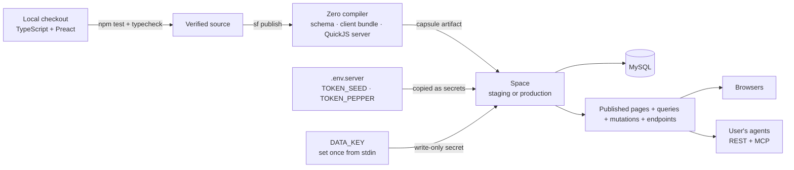

# Operations and development

This document covers the practical side: what to install, how to run it, what the environment
variables mean, how publishing works, what is tested, and where the sharp edges are.

## 1. Repository layout

```
.
├── spacefast.config.ts     Zero runtime config: server and client entry points
├── package.json            Two production dependencies; test/typecheck scripts
├── theme.json              Color palette and body font for the Zero/Tailwind build
├── shared/
│   ├── contract.ts         Enums, limits, validation, URL/date helpers
│   └── prompts.ts          Onboarding/update prompts, agent guide, TTL constants
├── server/
│   ├── index.ts            Schema, queries, mutations, endpoints
│   ├── data.ts             All user-data reads/writes and agent auth
│   ├── access.ts           Membership, seats, invites, blocks, viewer state
│   ├── sealed.ts           Sealed field map and legacy upgrade
│   ├── vault.ts            SIV encryption and keyed hashes
│   ├── tokens.ts           Secret minting/hashing and time helpers
│   └── mcp.ts              JSON-RPC MCP server
├── client/
│   ├── index.tsx           Layout, auth/membership gate, navigation
│   ├── ui.tsx              Shared UI: dates, money, badges, company marks, select
│   ├── JobDetail.tsx       Job drawer: status, notes, research details
│   ├── Drawer.tsx          Native <dialog> drawer with exit animation
│   ├── DeleteData.tsx      Type-DELETE confirmation flow
│   └── types.ts            Client-side view types
├── pages/
│   ├── index.tsx           / Opportunities
│   ├── agent.tsx           /agent Your agent
│   └── profile.tsx         /profile Profile & roles
├── tests/
│   ├── fake.ts             In-memory Zero context and request helpers
│   └── app.test.ts         33 tests across 9 suites
└── docs/                   This documentation
```

`.spacefast/` is git-ignored local build/deploy state. It contains the compiled server bundle,
the client bundle, the artifact/manifest and the last Space ID/version. Do not edit it by hand
or treat it as source.

## 2. Local commands

Requirements: Node.js 20+ (the Zero SDK declares `node >= 20`), npm, and the `sf` CLI for
development/publishing. The repository itself only declares npm dependencies.

```bash
npm install            # install @spacefast/zero, preact, tsx, typescript
npm test               # Node test runner: tests/*.test.ts via tsx
npm run typecheck      # tsc --noEmit --strict over server, shared, client, pages
npm run dev            # = sf dev
npm run publish        # = sf publish
```

Useful Spacefast commands:

```bash
sf dev                          # local server
sf dev --state-backend sqlite   # keep local state across restarts
sf publish                      # compile and publish
sf logs runtime --follow        # tail published server logs
sf db                           # inspect the live schema
sf db dump                      # print rows
```

`sf dev` supports guests only, so member-only screens are best exercised against a deployed
Space. Local state is in memory and resets on restart unless `--state-backend sqlite` is used.

## 3. Dependencies

### Production

| Package | Version | Why |
| --- | --- | --- |
| `@spacefast/zero` | 0.8.0 | Server and client SDK: `capsule`, `table`, `query`, `mutation`, `endpoint`, `useQuery`, `useMutation`, auth, kit, content/charts exports |
| `preact` | 10.29.8 | UI runtime |

### Development

| Package | Version | Why |
| --- | --- | --- |
| `tsx` | ^4.23.15 | Runs TypeScript tests directly (`tsx --test`) |
| `typescript` | ^6.0.3 | Strict typecheck |

### Platform-provided, not in `package.json`

`@spacefast/zero/client`, `/server`, `/kit`, `/charts`, `recharts`, `lucide-react` and the
platform runtime are served by Spacefast and do not count toward the 8 MB client bundle cap.
Import only what you use; unused platform modules are never fetched.

### Deliberately absent

No ORM or MySQL driver, no HTTP client, no auth library, no validation library, no CSS/PostCSS
pipeline, no state manager, no router library, no test framework beyond `node:test`, no
bundler config. Zero supplies the runtime behavior; the app is plain TypeScript + Preact.

## 4. Configuration

### 4.1 Secret variables

| Variable | Purpose | Where to set it | Notes |
| --- | --- | --- | --- |
| `TOKEN_SEED` | Entropy source for `ctx.jwt.sign` when minting `nmh_`/`nmk_` secrets | `.env.server` (synced by `sf publish`) | A base64url 32-byte Ed25519 seed is the documented shape. It is used only as an entropy source; rotating it changes future mint entropy, not stored hashes. |
| `TOKEN_PEPPER` | HMAC key for `hashSecret` and the mint derivation | `.env.server` | Rotating it invalidates every issued key and code. Plan and communicate. |
| `DATA_KEY` | Key for field encryption, owner IDs, email hashes and the data-key fingerprint | Space secret, set once from stdin | **Never** in `.env.server`. Losing it loses every encrypted value and owner correlation. No rotation. |

Set `DATA_KEY` once, without exposing it in shell history or a file:

```bash
openssl rand -base64 32 | tr -d '\n' | sf env set DATA_KEY --secret --value-from-stdin
```

`sf publish` copies every key in `.env.server` into the Space as a secret, so that file must
contain only values intended for production. A test (`deployment safety`) fails if `DATA_KEY`
appears there. Keep an offline copy of `DATA_KEY` if the operator prefers recoverability over
never having a copy.

### 4.2 Optional membership configuration

These are ordinary (non-secret) Space variables, set with `sf env set`, not `.env.server`:

```bash
sf env set MEMBER_CAP --no-secret --value "50"
sf env set ALLOWED_EMAILS --no-secret --value "person@example.com,other@example.com"
sf env set ALLOWED_USER_IDS --no-secret --value "user_abc,user_def"
sf env set BLOCKED_EMAILS --no-secret --value "bad@example.com"
sf env set BLOCKED_USER_IDS --no-secret --value "user_bad"
```

| Variable | Default | Effect |
| --- | --- | --- |
| `MEMBER_CAP` | 50 | Open seats. `0` means invite-only from the start. A non-numeric value falls back to 50. |
| `ALLOWED_EMAILS` | empty | Invitations. Must be a verified email; case-insensitive. Invited people skip the cap check but count toward the total after joining. |
| `ALLOWED_USER_IDS` | empty | Invitations by exact account ID. Useful when the provider has no email. |
| `BLOCKED_EMAILS` | empty | Blocks the person and all their agents; frees their seat; keeps their data. Case-insensitive. |
| `BLOCKED_USER_IDS` | empty | Same, by exact account ID. |

All lists are comma-separated and trimmed; empty entries are ignored. Emails are normalized to
lowercase; user IDs are compared exactly. The raw lists live in env (operator-visible) but are
hashed with `DATA_KEY` before comparison with stored identities.

### 4.3 Theme and runtime config

- `spacefast.config.ts` declares `runtime.kind: "zero"`, `server: "server/index.ts"`,
  `client: "client/index.tsx"`.
- `theme.json` defines the `accent` (`#2f6b4f`) and `background` (`#f7f8f3`) palette and the
  Inter body font. Zero compiles Tailwind classes and tokens; there is no CSS pipeline.
- The client marks a staging deployment when `location.hostname` contains `staging`; it turns
  the sidebar red and shows a Staging badge. This is a UI parity feature, not an env check.

## 5. Publishing and schema changes



`sf publish` compiles the capsule and publishes it to the Space configured in
`.spacefast/space.json` / the CLI link. It:

- bundles the client (Preact pages, components, static Tailwind classes);
- compiles the server to a QuickJS module (`.spacefast/zero/server.qjs.mjs`);
- records the pages, schema, indexes, auth config and migrations in
  `.spacefast/zero/artifact.json` and `finalize.json`;
- copies `.env.server` keys into the Space as secrets;
- applies the schema migration at finalize (the current artifact has no migration operations).

Before publishing:

1. Run `npm test`.
2. Run `npm run typecheck`.
3. Confirm `.env.server` contains only production `TOKEN_SEED`/`TOKEN_PEPPER` (no `DATA_KEY`).
4. If headers are overridden on `json()`/`text()`, use the exact casing (`Content-Type`).
   A lowercase duplicate passes `sf dev` but production answers `500
   zero_response_header_invalid`.
5. If a table field was added/removed, note that dropping/renaming a column needs a manual
   migration. The old plaintext columns (`email`, `ownerEmail`, `displayName`) remain for this
   reason.

Schema constraints to remember:

- Field kinds are `string()`, `boolean()` and `id("table")`; numbers and dates are stored as
  strings.
- Every row gets `id`, `createdAt`, `updatedAt` for free; those names are reserved.
- Indexes are declared with `.index(name, fields)` and read with `withIndex`.
- There are no foreign keys or unique constraints; the app enforces those relationships.
- One server entry and an optional client layout module, as declared in the config.

## 6. Observability

| Signal | Where |
| --- | --- |
| Agent runs | `runs` table, shown newest-first (latest 20) on **Your agent** |
| Key activity | `agentKeys.lastUsedAt`, updated at most once per minute on write-capable requests |
| Connected keys | **Your agent** table: label, kind, last used, expiry, active/revoked |
| Runtime errors/logs | `sf logs runtime --follow` |
| Schema | `sf db` |
| Rows | `sf db dump` |
| Compiled artifact | `.spacefast/zero/artifact.json`, `finalize.json` |

The app itself does not call `ctx.log`/`console`, and there is no metrics, tracing or read
audit. A failed request that is not a `ContractError`/`RequestError` is rethrown so the
transaction rolls back; the platform/runtime log is the place to see it. The UI's **Recent
agent runs** is the product-level activity feed.

## 7. Testing

```bash
npm test
npm run typecheck
```

`tests/fake.ts` implements the subset of the Zero context the app uses:

- `withIndex(eq)`, `collect`, `first`, `take`, `order`;
- `get`, `insert`, `update`, `delete`;
- `auth`, `env`, `invalidate`;
- `crypto.hmacSha256`, `crypto.sha256`, `crypto.timingSafeEqual`;
- `jwt.sign` with a random `jti`, like the runtime.

It uses `node:crypto` and injects test secrets (`TOKEN_SEED`, `TOKEN_PEPPER`, `DATA_KEY`), so
the suite runs without the platform. `makeCtx` can override secrets (for a different
`DATA_KEY`) and `request` builds a minimal `EndpointRequest`.

The 33 tests cover:

| Suite | What it proves |
| --- | --- |
| `contract` | Canonical URLs, URL/date validation, all-problems-at-once, https-only icons |
| `access` | Seat cap, invites, sign-in ≠ join, no eviction, blocking frees a seat and stops agents |
| `handoff codes and keys` | Single use, expiry, uniqueness, revocation, blocked/expired/unknown keys, key ownership, 90-day MCP keys |
| `agent writes` | Role prerequisite, atomic batches, status/notes/firstFound preservation, URL dedupe, icon-only writes, no cross-user access, profile replacement |
| `delete my data` | Every owned row removed for both IDs, agents stop, other users unaffected, blocked users can delete |
| `MCP endpoint` | Handshake, protocol negotiation, 202 notifications, tool list, shared rules, auth/origin/malformed rejection |
| `encryption at rest` | Round-trip (emoji/CJK/surrogates), determinism, context binding, tamper detection, different key, no plaintext in the DB |
| `upgrading data from before encryption` | Returning member, old agent key, blocked legacy member, idempotent hashed IDs |
| `deployment safety` | `.env.server` never contains `DATA_KEY` |

Not covered by the suite: browser rendering, real live-query propagation, real platform auth,
external URL fetching, concurrency (the seat race is acknowledged), load/performance, and MCP
SSE (not implemented). Add tests when changing a rule; the suite is the executable spec.

## 8. Known limitations and future work

From the README's "Not built yet":

- OAuth for ChatGPT/Claude.ai connectors (the MCP key model is for coding agents that can set
  a header).
- Importing application statuses and notes from the old single-user app. Research imports
  through the agent API unchanged; statuses/notes would need a migration.
- Cleaning up expired handoffs. They are harmless but accumulate. Keys also remain after
  expiry/revocation.

Known architectural limits:

- The seat cap count + insert is not atomic; two last-seat claims can both succeed.
- Deterministic encryption reveals unchanged/equal values in the same context.
- No `DATA_KEY` rotation; losing it loses the data. No backup/restore story in the app.
- The sign-in record and Spacefast backups outlive "Delete my data".
- No app-level rate limiting, spend control, metrics, tracing or read audit.
- The UI loads all jobs for an owner (up to 1,000) and has no pagination; queries re-run whole
  result sets on invalidation.
- MCP is a deliberately small subset: no SSE, no batch, no resources/prompts, no sessions.
- No browser/E2E test suite and no local member auth (`sf dev` is guest-only).

## 9. Extension guide

### Adding a private field

1. Add the column in `server/index.ts` (`string()` with a default if needed).
2. Add it to `SEALED` in `server/sealed.ts` if it is private.
3. Add it to the relevant view (`profileView`, `trackView`, `jobView`) and, if agents may read
   it, to `agentContext` explicitly.
4. Add it to the validator in `shared/contract.ts`.
5. Add it to the MCP schema in `server/mcp.ts` if agent-writable.
6. Update the prompt/guide text in `shared/prompts.ts` if agents must populate it.
7. Add tests for round-trip, agent visibility and cross-owner isolation.
8. Existing rows: a new sealed field reads as `""`; plan a backfill if that is not acceptable.

### Adding an agent operation

1. Write a validator in `shared/contract.ts` that reports **all** problems and throws
   `ContractError`.
2. Write the function in `server/data.ts` with `ownerId` as a parameter. Never accept an owner
   from the payload.
3. If it is user-only, do not expose it to agents. If it is agent-facing, add both a REST
   endpoint in `server/index.ts` and an MCP tool in `server/mcp.ts`, or deliberately only one
   lane.
4. Decide which fields it may write. If it is a narrow write (like icons), update only those
   fields.
5. Call `ctx.invalidate()` after a successful write.
6. Update `shared/prompts.ts` so agents know how to use it.
7. Add tests for: validation atomicity, owner scoping, preserved user-only fields, and the
   capability boundary.

### Adding a page

1. Create `pages/<name>.tsx` starting with `"use client"` and export a default component.
2. Read with `useQuery`; write with `useMutation`. Do not call your own REST endpoints from
   the UI.
3. Add navigation in `client/index.tsx` if it is a primary page.
4. Use kit components and static Tailwind classes (no `bg-${tone}-500`); prefer semantic
   tokens (`canvas`, `surface`, `ink`, `line`, `accent`, `success`, `warning`, `danger`).
5. Respect the membership gate; page content is inside `Layout`, which only renders the shell
   for `member`.
6. Keep accessibility: labels, focus, keyboard path, reduced motion.

### Safe-change checklist

- [ ] `npm test` passes.
- [ ] `npm run typecheck` passes.
- [ ] No new npm import in `server/` (platform + own files only).
- [ ] No outbound fetch in handlers.
- [ ] Every new row read/write goes through `data.ts` and checks ownership.
- [ ] Agent-writable payloads are allowlisted; status/notes stay user-only.
- [ ] New private fields are in `SEALED` and go through `seal`/`openRow`.
- [ ] New secrets are named, not read; `DATA_KEY` never in `.env.server`.
- [ ] Header casing exact if overridden.
- [ ] Prompts/guide updated for any agent-facing change.
- [ ] Tests cover the new rule and the cross-owner case.

## 10. Runbooks

### A key leaked

1. Open **Your agent → Connected agents** and revoke the key.
2. If the compromise is broader than one key, add the person to `BLOCKED_EMAILS` or
   `BLOCKED_USER_IDS`. Their agents stop on the next request and their seat frees.
3. Review **Recent agent runs** for unexpected writes.
4. Remember the blast radius: research writes, context reads and run logs. The key cannot
   change status/notes, delete, or reach another owner.

### A handoff code leaked

- A code is single-use and expires in 30 minutes. Blocking the person stops redemption
  immediately. There is no per-code revoke endpoint.
- If it was already redeemed, revoke the resulting session key in **Connected agents**.

### `TOKEN_PEPPER` needs rotating

Rotating it invalidates every stored key hash and code hash. Users must generate new prompts
and MCP keys; existing keys stop authenticating. Communicate before rotating.

### `DATA_KEY` is lost

There is no recovery and no rotation. Restore the original key from an offline copy if one
exists. Do **not** set a new key and expect old values to work: `open()` fails loudly with a
key-fingerprint error instead of returning garbage. Without the original key, encrypted
fields and owner correlations are unrecoverable.

### A deploy is bad

Revert the source change and republish. If the change involved a destructive schema migration,
you may need a manual migration; the app does not ship one. Header-casing mistakes show up only
in production (`500 zero_response_header_invalid`), so test endpoints after publishing.

### A user asks what is stored

- **Export everything** on **Profile & roles** downloads the full workspace JSON.
- **Delete my data** removes all eight tables for their account; it does not remove the
  Spacefast sign-in record or backups. The UI tells them this.
- Private fields are encrypted; job postings are plain; notes are never sent to agents.

## 11. Where to look next

- [architecture.md](architecture.md) — components, module graph, request paths, tradeoffs.
- [data-model.md](data-model.md) — tables, fields, indexes, invariants.
- [flows.md](flows.md) — sign-in, handoff, MCP, onboarding, update, deletion, upgrade.
- [security.md](security.md) — threat model and residual risks.
- [api.md](api.md) — routes, MCP tools, payloads, validation.
- The source: `server/index.ts` for the surface, `server/data.ts` for the rules,
  `server/access.ts` for membership, `server/vault.ts` for crypto.
