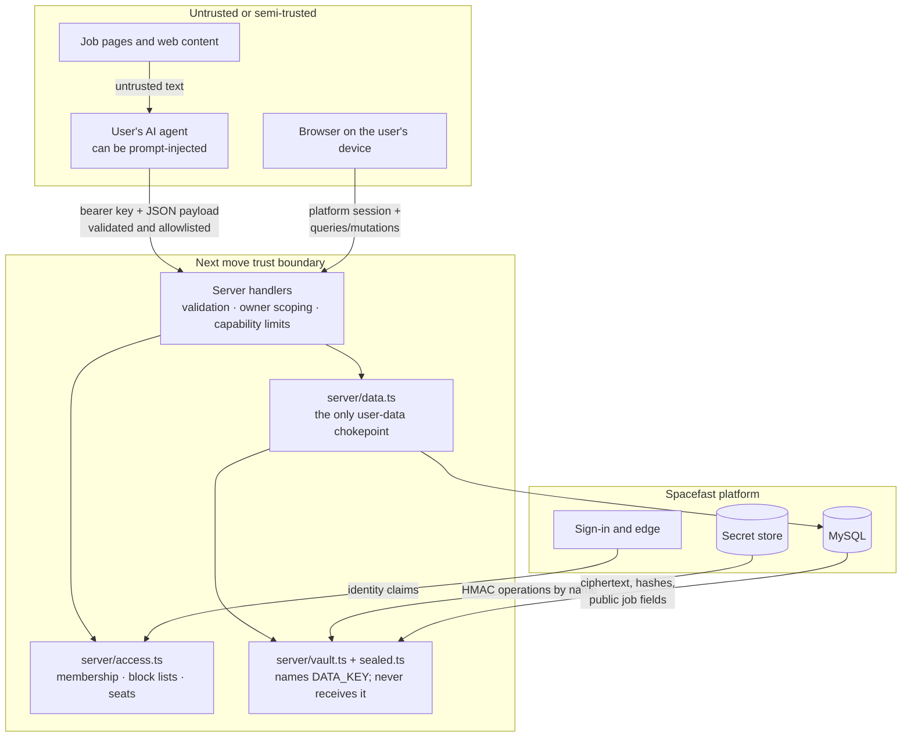

# Security model

The security model is easiest to read as four separate questions:

1. **Who is this?** — platform sign-in for the UI, bearer keys for agents.
2. **Are they allowed in?** — membership and block lists, re-checked on every request.
3. **What may they do?** — a deliberately narrow agent capability set, enforced in `server/data.ts`.
4. **What can be read if the database leaks?** — private fields are encrypted; identities are keyed hashes.

The goal is not to defend against Spacefast itself. The README is explicit: deploying code that
decrypts on purpose, or the platform holding both the data and the key, defeats the model. The
goal is to make reading someone's private data a deliberate act rather than a glance at a
dashboard, a dump or an export.

## 1. Trust boundaries



Two boundaries matter:

- **The agent is not trusted to behave.** It may be confused by a malicious job page or a
  hijacked instruction. The server does not rely on the prompt for authorization; it relies
  on the key's owner and the allowlisted operations.
- **The browser is not trusted with other users' data.** It never receives an owner ID to
  submit. The server derives the owner from the session or key.

The operator sits outside this diagram. With dashboard/DB access they see ciphertext, hashes
and public job data. With the ability to deploy code and use `DATA_KEY`, they can decrypt
deliberately. That is an acknowledged limit, not an accident.

## 2. Identity and pseudonymity

| Concept | Stored form | Derivation | What it means |
| --- | --- | --- | --- |
| Account ID | — | `ctx.auth.userId` | Platform identity; never stored in new rows. |
| Owner ID | `o1_` + 32 hex | `HMAC(DATA_KEY, "owner|" + userId)` | Every user row is keyed by this. Without DATA_KEY, a row can't be matched to a person on Spacefast's Users page. |
| Email | — | `ctx.auth.email`, verified | Used for invitations, blocks and member display; never stored in clear for new rows. |
| Email hash | `h1_` + 32 hex | `HMAC(DATA_KEY, "email|" + lowercasedEmail)`; `""` stays `""` | The only form stored; used for block checks and membership. |
| Display name | — | `ctx.auth.displayName` | Shown in the UI; not persisted. |

Consequences:

- A database dump does not contain a usable email list, a user ID list or a display-name list.
- Block lists are provided as raw emails/user IDs in env, but are hashed at request time before
  comparison with stored identities. The env values themselves are operator-visible.
- Losing `DATA_KEY` does not just lose encrypted text: it also makes owner IDs and email
  hashes impossible to correlate with the platform's accounts.

## 3. Authentication

### 3.1 UI

The platform handles sign-in (Google or WordPress.com). `ctx.auth` exposes `userId`,
`displayName`, `email`, `emailVerified`, `isAuthenticated` and related claims. The app never
handles passwords or OAuth tokens itself.

- `identity()` returns `null` unless `isAuthenticated` and `userId` exist.
- `verifiedEmail()` returns `""` unless the provider reports a verified email
  (`emailVerified !== false`). An unverified email cannot satisfy an email-based invitation or
  block; a user ID can still be used.
- A signed-in visitor is not a member. `memberOrNull` / `requireMember` check the `members`
  table (and block lists) separately.

### 3.2 Agent bearer keys

Every agent route except `POST /api/agent/session` and `GET /api/agent/guide` requires:

```
Authorization: Bearer nmk_<43 base64url characters>
```

`authenticateAgent`:

1. Matches the exact bearer format. Anything else returns `null` → `401`.
2. Computes `hashSecret` (HMAC-SHA256 under `TOKEN_PEPPER`) and looks the key up through the
   `by_hash` index. The plaintext key is never stored.
3. Rejects a missing row, `revokedAt` set, or `expiresAt <= now`.
4. If the key belongs to a pre-encryption owner, upgrades that owner (only on a write-capable
   request), then reloads the key row.
5. Re-checks `isMember(ownerId, emailHash)`, which includes block lists.
6. Records `lastUsedAt` at most once per minute on write-capable requests.

Two key kinds:

| Kind | Issued by | Lifetime | Intended use |
| --- | --- | --- | --- |
| `session` | `POST /api/agent/session` redeeming a one-time code | 6 hours | A single agent run / pasted prompt |
| `mcp` | `createMcpKey` mutation | 90 days | Persistent MCP client configuration |

Both are revoked the same way: `revokeKey`, which checks the key belongs to the signed-in
member.

### 3.3 One-time handoff codes

`createHandoff` mints an `nmh_` code and stores only `codeHash`. A code is valid if:

- the format matches `^nmh_[A-Za-z0-9_-]{43}$`,
- a row with that `codeHash` exists,
- `usedAt` is empty,
- `expiresAt` is in the future (30 minutes),
- and the owner is still a member (not blocked).

Redemption issues a session key and marks the handoff used in the same transaction. The
response includes `apiKey`, `expiresAt` and `purpose`. A code cannot be revoked individually;
the options are to wait 30 minutes, revoke the issued key in **Your agent**, or block the
person (which stops all their agents on the next request).

### 3.4 How secrets are minted without randomness

Zero handlers have no `crypto.getRandomValues`, no `TextEncoder` and no `btoa`. `server/tokens.ts`
takes entropy from the runtime:

```text
seed    = ctx.jwt.sign({ key: "TOKEN_SEED", kid: "mint", claims: { use: prefix }, ttlSeconds: 60 })
secret  = prefix + "_" + base64url(HMAC(TOKEN_PEPPER, "mint:" + seed))
stored  = HMAC(TOKEN_PEPPER, "store:" + secret)
```

`ctx.jwt.sign` includes a fresh random `jti` supplied by the runtime and is keyed by
`TOKEN_SEED`; HMAC-ing the resulting token with `TOKEN_PEPPER` yields 256 bits that cannot be
predicted without both secrets and the runtime's randomness. The `use` claim distinguishes
`nmh` and `nmk` mints. The storage hash uses a different label from the mint hash, so one
output never stands in for another.

If Zero adds a random-bytes API, `mintSecret` is the one place to swap it in.

## 4. Authorization: the capability matrix

"User UI" means the signed-in member using the web app. "Agent" means a valid `nmk_` key over
REST or MCP. "Other user" means a different member. "Operator" means someone with database
access but not the ability to deploy decrypting code.

| Capability | User UI | Agent | Other user | Operator with DB |
| --- | --- | --- | --- | --- |
| Read own profile | ✅ | ✅ | ❌ | ciphertext |
| Write own profile | ❌ (agent owns it) | ✅ | ❌ | ciphertext |
| Read own roles | ✅ | ✅ | ❌ | ciphertext |
| Write own roles | ❌ (only pause) | ✅ | ❌ | ciphertext |
| Read own jobs (posting data) | ✅ | partial | ❌ | plain |
| Read own fit / application status | ✅ | ✅ | ❌ | ciphertext |
| Read own notes | ✅ | ❌ | ❌ | ciphertext |
| Write own notes | ✅ | ❌ | ❌ | ciphertext |
| Change own status | ✅ | ❌ | ❌ | ciphertext |
| Save research jobs | ❌ | ✅ | ❌ | mixed |
| Set company icons | ❌ | ✅ | ❌ | plain |
| Log a run | ❌ | ✅ | ❌ | ciphertext summary |
| Create / revoke own agent keys | ✅ | ❌ | ❌ | hashes |
| Join / claim a seat | ✅ | ❌ | ❌ | members row |
| Delete own data | ✅ | ❌ | ❌ | rows deleted |
| Read another user's rows | ❌ | ❌ | ❌ | all rows, encrypted |
| Decrypt without DATA_KEY | app does it for them | only exposed fields | ❌ | ❌ |
| Decrypt by deploying code with DATA_KEY | — | — | — | ✅ (acknowledged limit) |

"Partial" agent job read means: key, role key, title, company name/website/icon, apply URL,
location, salary, fit, opening status, first/last verified dates, application status. The
agent does **not** receive notes, eligibility, workplace, salaryNote, fitSummary, caveats,
highlights or tags.

### Where each rule is enforced

| Rule | Code |
| --- | --- |
| Owner comes from the key/session, never the body | `asAgent` passes `key.ownerId`; UI mutations use `requireMember(ctx).ownerId`; `saveJobs` and friends have no owner parameter. |
| User can only touch their own job/role/key | `ownedJob`, `setTrackActive`, `revokeKey` compare `row.ownerId`. |
| Agents cannot write status/notes | `saveJobs` constructs an allowlisted research object; status is only sealed as `shortlisted` on insert; notes is only `""` on insert. |
| Agents never see notes | `agentContext` explicitly picks fields; it never spreads the row. |
| Agents cannot delete or manage keys | No such tool/route exists; MCP has a fixed tool list. |
| Whole batch or nothing | Validators throw `ContractError` before writes; endpoint `asProblem` maps it to 400; unexpected errors rethrow to roll back. |
| Only members get in | `memberOrNull` / `requireMember` for UI; `isMember` inside `authenticateAgent` and `redeemHandoff`. |
| Keys are stored hashed | `issueKey` stores `hashSecret(secret)`; `redeemHandoff` stores `hashSecret(code)`. |
| Private fields are sealed | `SEALED` map + `sealFields` / `openRow`. |

## 5. Encryption at rest

### 5.1 Scheme

`server/vault.ts` builds deterministic authenticated encryption in the SIV style, using only
HMAC-SHA256:

```text
K        = DATA_KEY (secret; handler passes its name, never its value)
context  = "<table>|<ownerId>[|<rowKey>]|<field>"
iv       = HMAC(K, "siv|" + context + "\0" + utf8(text))[0..15]          (16 bytes, 32 hex)
keystream= HMAC(K, "ks|" + iv + "|0") ‖ HMAC(K, "ks|" + iv + "|1") ‖ …   (32 bytes per block)
body     = utf8(text) XOR keystream
stored   = "e1." + kid + "." + hex(iv) + "." + base64url(body)
kid      = HMAC(K, "kid|") first 4 bytes                                  (8 hex)
```

`open()` re-reads the header, checks the `kid`, decrypts, recomputes the `siv` HMAC and
compares it to the stored `iv` with `timingSafeEqual`. A different `kid` fails before decryption with a clear
message instead of returning garbage. An empty string is stored as `""` and opened as `""`.

Each of the labels (`siv|`, `ks|`, `owner|`, `email|`, `kid|`) separates the uses of the same
key, so no HMAC output can be substituted for another purpose.

### 5.2 What the context binding buys

A ciphertext sealed for `jobs|o1_…|acme-em|notes` cannot be opened as:

- another user's notes (`o1_…` differs),
- another job's notes (`acme-em` differs),
- another field (`notes` differs),
- another table (`jobs` differs).

The integrity check also catches a flipped byte in the body, a malformed base64url value and a
different key. Tests cover determinism, context binding, tamper detection and a different key.

### 5.3 Determinism and its cost

There is no randomness in the sandbox, so the scheme is deterministic: the same text in the
same context produces the same ciphertext. That is what makes the legacy upgrade idempotent and
safe to run concurrently. The cost is that an observer of the database can tell when a field
did not change, and can correlate equal values written under the same context. The README
describes this honestly as revealing "this field didn't change".

### 5.4 Key handling

- `DATA_KEY` is a write-only Space secret. Handler code passes the *name* to
  `ctx.crypto.hmacSha256`; the value never enters JavaScript and Spacefast never shows it again
  after it is set.
- Set it once, from a generator, without putting it in a file or shell history:
  `openssl rand -base64 32 | tr -d '\n' | sf env set DATA_KEY --secret --value-from-stdin`
- **Never** put `DATA_KEY` in `.env.server`. `sf publish` copies every key in that file into
  the Space; a publish would replace the production key and make all existing ciphertext
  unreadable. A test in `tests/app.test.ts` fails if it appears there.
- There is no rotation yet. Losing the key means losing every encrypted value and every owner
  correlation. Keep an offline copy if that risk is acceptable to the operator.
- `TOKEN_SEED` and `TOKEN_PEPPER` belong in `.env.server` (production values only). Rotating
  `TOKEN_PEPPER` invalidates every issued key and code; rotating `TOKEN_SEED` does not rewrite
  stored hashes but changes future mint entropy.

### 5.5 What is intentionally plain

Job postings are public: title, company, URLs, location, salary, highlights, tags, source and
dates. The app deduplicates and looks rows up by them. The operator can read them, and so can
anyone with a database dump. The combination of saved jobs still reveals interests; this is
discussed in the residual risks.

## 6. Membership and access control

### 6.1 Seat model

- Default cap: 50 (`MEMBER_CAP`). `MEMBER_CAP=0` makes Next move invite-only from the start.
- Signing in does not take a seat; `join` inserts the member row.
- Invitations (`ALLOWED_EMAILS`, `ALLOWED_USER_IDS`) skip the cap check but count toward the
  total once joined.
- Filling up or lowering the cap never removes an existing member. The cap is checked once, at
  join.
- A blocked member is not counted by `seatsLeft`, so blocking frees a seat without deleting
  data.
- `seatsLeft` scans all member rows through the built-in `by_creation` index. At this scale
  that is cheaper and less error-prone than a counter.

### 6.2 Block lists

`BLOCKED_EMAILS` / `BLOCKED_USER_IDS` are comma-separated. Emails compare case-insensitively;
user IDs compare exactly. On each request context, the lists are hashed with `ownerIdFor` and
`emailHashFor` (cached per context in a `WeakMap`) and compared with stored identities. A
blocked person:

- sees `no_access`, reason `removed`;
- fails `isMember`, so `authenticateAgent` returns `null` and `redeemHandoff` returns 403;
- can still delete their data (`signedInOwnerIds` does not require membership);
- no longer holds a seat.

### 6.3 The seat race

`join` counts members and then inserts; those two operations are not atomic, and Zero has no
unique constraints. Two people claiming the last seat at the same moment can both get in. The
README calls the cap "a limit on growth, not a billing guarantee". The same check-then-insert
shape means a concurrent duplicate member/profile row is theoretically possible; the app reads
the first row, so the practical impact is an extra row and a double-counted seat, not a
privilege escalation.

## 7. MCP-specific hardening

The MCP endpoint is a public HTTP surface authenticated by a bearer key. Its additional
defenses:

| Defense | Behavior |
| --- | --- |
| Foreign `Origin` rejected | If an `Origin` header is present, its host must equal the request `Host`; otherwise `403 forbidden_origin`. Agents don't send `Origin`; browsers do. This blocks a web page from driving the endpoint with a user's credentials (DNS rebinding and similar). |
| Bearer only | No cookies, no ambient browser session. The key must be explicitly configured. |
| Fixed tool surface | Eight tools, each mapped to a `data.ts` function; unknown tools return `-32602`. |
| Stateless | No session state to fixate or leak; every request re-authenticates and re-checks membership. |
| No batch | JSON-RPC batch arrays are rejected with `-32600`. |
| No SSE | JSON responses only; `GET`/`DELETE /mcp` return `405`. |
| No-store | JSON-RPC responses carry `cache-control: no-store`. |
| Errors are honest but not leaky | `401` with `WWW-Authenticate`; validation returns the same `problems` list as REST; unexpected errors rethrow (rollback) rather than being converted into a success. |

MCP tool annotations (`readOnlyHint`, `destructiveHint`, etc.) are hints to the client, not
the enforcement mechanism. The server enforces the rules in `data.ts` regardless of what the
client believes.

## 8. Deletion and retention

`deleteAccount`:

- requires a signed-in identity (not membership), so blocked people can erase their data;
- requires the literal confirmation string `"DELETE"` (the UI also asks the user to type it);
- computes `signedInOwnerIds` = `[hashed ownerId, raw userId]`, covering post- and
  pre-encryption rows;
- loops the eight owned tables and deletes every matching row; membership is last, so the seat
  frees only after everything else is gone;
- runs inside the mutation transaction: everything or nothing;
- includes agent keys (their agents stop working) and handoffs.

It cannot remove:

- Spacefast's sign-in record (email + linked provider) — operator action in the Spacefast
  dashboard;
- Spacefast backups, if any; retention is not documented to the app;
- platform logs or edge telemetry that the app does not control.

Expired handoffs and keys are not cleaned up automatically. That is harmless for security but
means rows accumulate. The README lists handoff cleanup as not built yet.

## 9. Threat model

| Threat | Mitigation | Residual risk |
| --- | --- | --- |
| Database dump or dashboard browsing | Private fields sealed; owner IDs/emails keyed hashes; credentials hashed. | Public job data, row counts, timestamps; deterministic equality; an operator who can deploy code. |
| Stolen agent key | Short expiry, revocable, narrow capability, no notes/status/delete, owner-scoped. | The thief can read context and write research/icons/runs/logs until revoked; MCP keys last 90 days. |
| Prompt injection from a malicious job page | Guide says treat pages as data; server ignores prompt content and enforces capabilities. | The agent's research can be manipulated or wrong; the person reviews before acting. |
| Cross-user access (IDOR) | Owner from key/session; `ownedJob`/owner checks; no owner in payload. | None known in the app paths; tests cover another user's job/notes/key. |
| Guessing codes/keys | 256-bit HMAC-derived secrets; 30-minute single-use codes; 6-hour session keys. | No app-level rate limiting; the platform edge may provide some. |
| Replay of a used code | `usedAt` check in the same transaction as issuance. | A leaked code can be redeemed once before the user; then it is dead. |
| Blocked person keeps using an old key | `isMember` re-checked on every request. | Requests already in flight at the moment of blocking can complete. |
| CSRF / DNS rebinding against `/mcp` | Foreign `Origin` rejected; bearer header required. | A non-browser client can always send the bearer if it has it. |
| Operator casual snooping | Encryption + pseudonyms + write-only key. | The platform holds both data and key; deploying decrypting code defeats it. |
| Lost `DATA_KEY` | Offline copy recommended. | No rotation/recovery; loss is permanent data loss. |
| Seat-cap abuse | Cap checked at join; invites explicit. | Count-then-insert race; no billing guarantee. |
| Spam or runaway agent loops | Batch caps, job caps, key expiry/revoke. | No app-level rate limiting or spend control; the user's own agent does the work. |
| Malicious link/icon data | URLs validated as absolute http(s) (https for icons); UI renders text, links open with `noopener noreferrer`; icons have `referrerpolicy="no-referrer"`. | The browser still contacts the company's site; a malicious image host sees the user's IP. |
| Backup exposure | Out of the app's control. | Spacefast's backup retention is undocumented. |

## 10. Residual risks and honest limits

1. **The app trusts the agent's research quality.** Validation checks structure, URLs, enums,
   dates and dedupe, not whether a salary claim is true or a role is actually a fit. The person
   is the final reviewer.
2. **The agent can exfiltrate its own key.** If the agent or its environment is compromised, the
   key is compromised. Revoke it; the blast radius is research writes, context reads and run
   logs.
3. **Deterministic ciphertext leaks equality and approximate length.** An observer can see that
   a field was unchanged and correlate identical values in the same context. They cannot
   recover the text without the key.
4. **The operator can become an attacker.** Deploying code that calls `ctx.crypto` with
   `DATA_KEY` can decrypt. This is documented rather than solved.
5. **The seat cap is approximate.** Two simultaneous claims can exceed it; there are no unique
   constraints.
6. **No app-level rate limiting or abuse budget.** Codes and keys are hard to guess, but a
   valid key can call the API as often as the platform allows.
7. **The sign-in record and backups outlive "Delete my data".** The app tells the user this and
   offers deletion of everything it controls.
8. **Reads are not audited.** There is no read log; `agentKeys.lastUsedAt` and `runs` are the
   only activity signals.
9. **Notes are encrypted at rest but readable in the browser.** A compromised device, a
   malicious extension or an XSS in the app would see them. The UI renders research as text
   and does not use `dangerouslySetInnerHTML`, but the browser is the endpoint.
10. **No OAuth for ChatGPT/Claude.ai connectors.** Those integrations would need an OAuth layer
    on top of the current bearer-key model.

## 11. Operational rules that protect the model

- `.env.server` is synced to production by `sf publish`; it may contain only production
  `TOKEN_SEED` and `TOKEN_PEPPER`.
- `DATA_KEY` is set once with `sf env set --secret --value-from-stdin`. Never in
  `.env.server`; never printed; keep an offline copy if the loss risk is acceptable.
- Rotating `TOKEN_PEPPER` invalidates every issued key and code. Plan and communicate it.
- Use the exact header casing (`Content-Type`, not `content-type`) when overriding headers on
  `json()`/`text()`; production rejects a lowercase duplicate with a 500.
- Run `npm test` and `npm run typecheck` before publishing. The test suite includes a
  deployment-safety check for `DATA_KEY` in `.env.server`.
- Revoke a leaked key immediately; block the person if the compromise is broader.
- If a handoff code leaks, blocking stops redemption; otherwise wait out the 30 minutes and
  revoke any unexpected connected agent.

Continue with [api.md](api.md) for the exact routes and payloads, or
[operations.md](operations.md) for deployment and testing.
